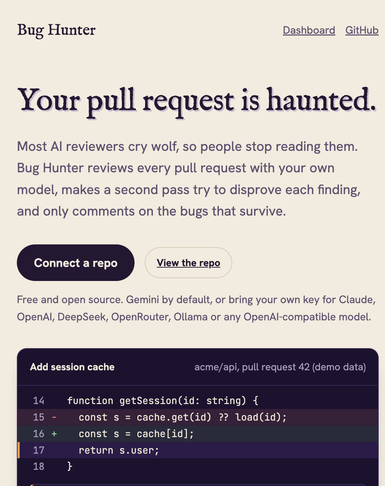

# Bug Hunter 🎃

> *"Every PR is haunted. Bug Hunter finds the spirits before they reach production."*

An open-source AI code reviewer that hunts bugs and security holes in GitHub pull
requests — powered by your LLM (Google Gemini by default; or Claude, OpenAI,
OpenCode Go, DeepSeek, and any OpenAI-compatible model) — then posts a themed 🔮 Séance
Report with fixes.

Built at **GDG Sunderland Hacktoberfest 2026 AI Hack Day** ("Automate the Nightmare!").



## What it does

When a pull request opens, Bug Hunter:

1. Reads the diff and hunts for real bugs and security holes with **your model**.
2. Runs a second, skeptical **verifier** pass to throw out false alarms.
3. Detects **possession attempts** — hidden instructions trying to trick AI reviewers.
4. Posts a themed **🔮 Séance Report** ranking every finding by creature (💀 Demon … 🕸️ Cobweb).
5. Adds **inline comments** with one-click fixes and a **commit status** with the haunting level.
6. Fires an **n8n** workflow that logs each hunt to **Google Sheets** and sends a **Gmail**
   alert when a PR is haunted or possessed.

## Try it in 5 minutes

**No webhook or tunnel needed** — hunt a PR straight from the browser.

```bash
npm install
cp .env.example .env
# fill in .env (see Setup below), then:
npm run check:models      # list valid model ids for your provider
npm run dev               # http://localhost:3000
```

Then open **http://localhost:3000/connect**, paste a pull request URL, enter your
shared secret, and click **🔦 Hunt this PR**. The 🔮 Séance Report, inline comments and
commit status land on that GitHub PR.

Or from the shell:

```bash
curl -X POST http://localhost:3000/api/hunt \
  -H "X-BugHunter-Secret: <your N8N_SHARED_SECRET>" \
  -H "content-type: application/json" \
  -d '{"pr_url":"https://github.com/YOU/REPO/pull/N"}'
```

Requires Node 22+.

## Setup

Fill in `.env`:

- **LLM provider** — one of:
  - `google` (default): set `GOOGLE_GENERATIVE_AI_API_KEY` from
    [Google AI Studio](https://aistudio.google.com/).
  - `anthropic` (Claude) / `openai` / `opencode` (OpenCode Go) / `deepseek` /
    `openrouter` / `ollama` / `openai-compatible`: set `LLM_PROVIDER`, `LLM_API_KEY`,
    `LLM_MODEL_REVIEW` (and `LLM_MODEL_FAST`, optional), plus `LLM_BASE_URL` for
    `openai-compatible`. The Gemini key is only required for `google`.
- `GITHUB_TOKEN` — a fine-grained personal access token scoped to your repo
  (Contents: Read · Pull requests: Read & write · Issues: Read & write · Commit statuses:
  Read & write · Metadata: Read).
- `GITHUB_WEBHOOK_SECRET` — a random string; it must match the secret on your GitHub webhook.
- `N8N_SHARED_SECRET` — random, **at least 16 chars** (also the `X-BugHunter-Secret`
  for `/api/hunt` and `/api/connect`).
- `N8N_HUNT_WEBHOOK_URL` — optional, for the n8n workflow.
- `PUBLIC_URL` — optional; enables one-click webhook registration via `/api/connect`.

### Providers

| Provider | `LLM_PROVIDER` | `LLM_MODEL_REVIEW` example |
|---|---|---|
| Google Gemini | `google` | `gemini-2.0-flash` |
| Claude | `anthropic` | `claude-sonnet-4-5` |
| OpenAI | `openai` | `gpt-4o` |
| OpenCode Go | `opencode` | `glm-5.3` |
| DeepSeek | `deepseek` | `deepseek-chat` |
| OpenRouter | `openrouter` | `anthropic/claude-sonnet-4.5` |
| Ollama (local) | `ollama` | `qwen2.5-coder:14b` |
| Any OpenAI-compatible | `openai-compatible` | vendor model id |

To list the valid ids for your provider, run `npm run check:models`. If the default
`gemini-flash-latest` 404s on your account, set `GEMINI_MODEL_REVIEW` to a real id.

## Connecting a repo

There are three ways to point Bug Hunter at a repository:

1. **Hunt a PR now** (no setup) — the `/connect` page or `POST /api/hunt`.
2. **Webhook** — point the repo's webhook at `/webhooks/github` (content type
   `application/json`, secret = `GITHUB_WEBHOOK_SECRET`, events **Pull requests** +
   **Issue comments**). For localhost, forward it:
   ```bash
   npx smee -u https://smee.io/<your-channel> -t http://localhost:3000/webhooks/github
   # or: ngrok http 3000
   ```
   With `PUBLIC_URL` set, `POST /api/connect` creates the webhook for you.
3. **GitHub App (one-click install)** — set `GITHUB_MODE=app` plus `GITHUB_APP_ID`,
   `GITHUB_APP_SLUG` and `GITHUB_PRIVATE_KEY_PATH`; the landing's "Connect a repo" and
   `/summon` hand off to GitHub's app-install page, and `installation` webhooks keep the
   repo list in sync. This is the full CodeRabbit/Greptile-style flow.

## Endpoints

| Method | Path | Auth | Purpose |
|---|---|---|---|
| GET | `/` | none | landing page |
| GET | `/connect` | none | hunt a PR now / auto-connect a repo |
| GET | `/summon` | none | redirect to the GitHub App install page (app mode) or `/connect` |
| GET | `/dashboard` | none | recent hunts (in-memory) |
| GET | `/health` | none | liveness |
| POST | `/webhooks/github` | webhook signature | GitHub PR / issue-comment / installation events |
| POST | `/api/hunt` | `X-BugHunter-Secret` | run a hunt now: `{ "pr_url" }` or `{ owner, repo, pr }` |
| POST | `/api/connect` | `X-BugHunter-Secret` | create a repo webhook via the PAT (needs `PUBLIC_URL`) |
| GET | `/api/hunts` | `X-BugHunter-Secret` | recent hunts (JSON) |
| GET | `/api/hunts/:id` | `X-BugHunter-Secret` | one hunt (JSON) |

## How it works

```
GitHub PR webhook → verify signature + dedupe → fetch diff → filter files
→ annotated diff → model review (structured JSON) → validate/snap lines
→ verifier pass (drop false alarms) → possession check → Séance Report
→ post one themed comment + inline comments + status → POST hunt.completed → n8n (Sheets + Gmail)
```

## Repo rules (`.bughunter.md`)

Write team rules in plain English in a `.bughunter.md` file on your default branch.
Bug Hunter reads it from the PR's base branch (a PR can't change its own rules),
alongside `AGENTS.md` / `CLAUDE.md` / `.cursorrules`. Rules can add checks or tell
the hunter to ignore accepted patterns. Rules cannot switch off security findings.
Max 2,000 characters.

```markdown
# 🎃 Bug Hunter rules

## Always check
-

## Conventions we accept (don't flag)
-

## Extra attention (paths or areas)
-
```

All Halloween wording lives in [`prompts/voice.json`](prompts/voice.json) — edit it to
change the posted reports with no code changes. The LLM prompts live in
`prompts/review.system.md`, `prompts/review.user.md`, `prompts/verify.md` and
`prompts/seance.md`.

## n8n bonus

An n8n workflow (exported to `/n8n/`) receives each hunt result over a shared-secret
webhook, appends a row to a **Google Sheets** "Hunt Ledger", and sends a **Gmail** alert
for haunted/possessed PRs — with error handling that logs failures to a separate tab.

## Demo

See [`demo/README.md`](demo/README.md) for the haunted-candy-shop demo repo (five planted
bugs plus a hidden possession attempt), and [`docs/DEMO_RUNBOOK.md`](docs/DEMO_RUNBOOK.md)
for the 2-minute demo script.

## Development

- `npm run typecheck` — `tsc --noEmit`
- `npm test` — vitest (unit + in-process integration tests)
- CI runs both on every push and pull request (`.github/workflows/ci.yml`); the landing
  page auto-deploys to GitHub Pages on landing changes.

## Docs

- [`docs/PRIOR_WORK.md`](docs/PRIOR_WORK.md) — what existed before the event vs. what was built during it.
- [`docs/SUBMISSION.md`](docs/SUBMISSION.md) — paste-ready answers for the submission form.
- [`docs/DEMO_RUNBOOK.md`](docs/DEMO_RUNBOOK.md) — demo + troubleshooting.

## License

MIT — see [LICENSE](LICENSE).
