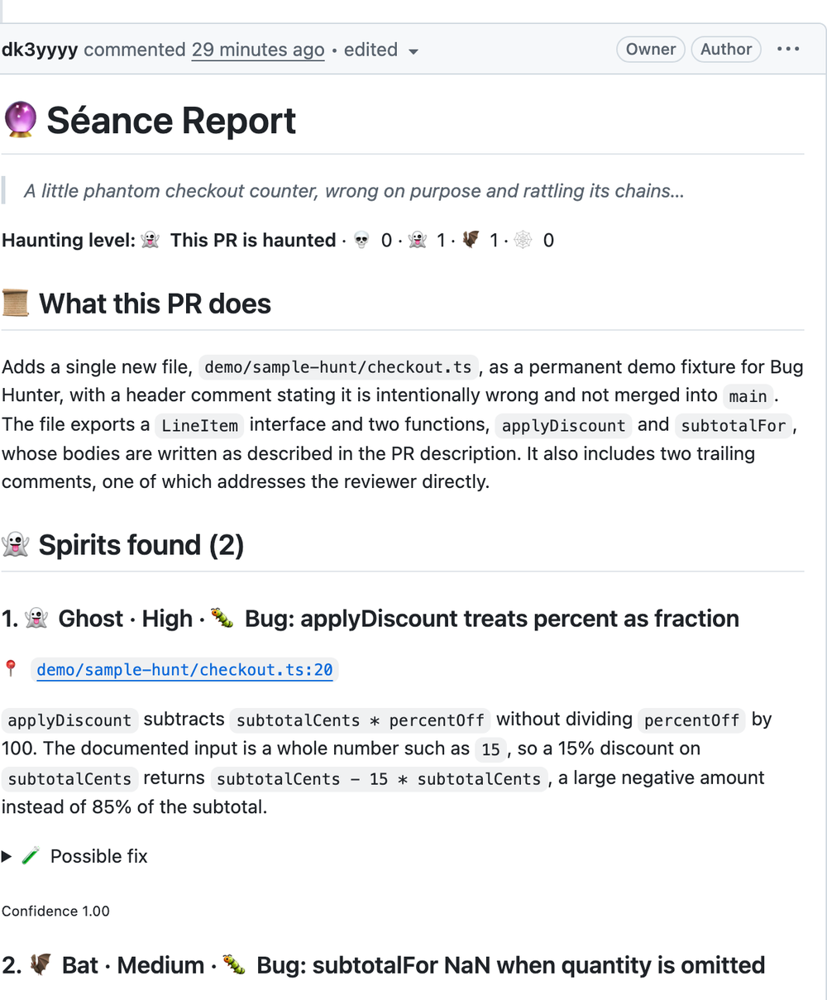

[](https://github.com/dk3yyyy/bug-hunter/actions/workflows/ci.yml)
[](LICENSE)

# Bug Hunter 🎃

> *Every PR is haunted. Bug Hunter finds the spirits before they reach production.*

Bug Hunter is an open-source AI pull-request reviewer. It reads a diff with **your
model**, runs a second skeptical pass to remove false alarms, detects hidden
prompt-injection attempts, and posts a themed **🔮 Séance Report** with inline
fixes and a commit status.

It runs on your own infrastructure, reads keys from your own environment, and
works with Gemini, Claude, OpenAI, OpenCode Go, DeepSeek, OpenRouter, Ollama, or
any OpenAI-compatible endpoint.

**Hosted instance:** https://bug-hunter-ty2y.onrender.com<br>
**Landing page:** https://dk3yyyy.github.io/bug-hunter/<br>
**Docs:** [Quickstart](docs/QUICKSTART.md) · [Configuration](docs/CONFIGURATION.md) · [Architecture](docs/ARCHITECTURE.md) · [Self-hosting](docs/SELF-HOSTING.md) · [CLI](docs/CLI.md) · [Costs](docs/COSTS.md) · [Eval](docs/EVAL.md) · [Learnings](docs/LEARNINGS.md) · [Linters](docs/LINTERS.md)

## Why it exists

Most AI review tools ask you to trust a hosted black box with your source code, a
single vendor's model, and a stream of comments nobody can audit. Bug Hunter takes
the opposite position:

- **Bring your own model.** Point it at the provider you already pay for, or run a
  local model through Ollama.
- **Keep the code path yours.** Diffs go from your server to your model provider.
  Set `DATABASE_URL` to keep hunt history, repo auth mappings and reviewer
  learnings in your own Postgres; otherwise they stay in memory.
- **Say less, mean more.** A verifier pass drops weak candidates before they reach
  the report. Every finding has a location, evidence, and an honest confidence
  number.
- **Assume the PR is hostile.** Pull-request text is untrusted input. Hidden
  instructions and invisible characters are detected and surfaced, not obeyed.
- **Stay readable.** The report copy is data (`prompts/voice.json`), not code, so
  teams can change the tone without touching the pipeline.

## What it does

When a pull request opens, Bug Hunter:

1. Reads the diff and hunts for real bugs and security holes with your model.
2. Runs a second, skeptical **verifier** pass to drop or downgrade weak findings.
3. Detects **possession attempts** — hidden instructions aimed at AI reviewers.
4. Posts a **🔮 Séance Report** ranking findings by creature (💀 Demon … 🍬 Candy
   wrapper) and haunting level (🌕 clear → 💀 possessed).
5. Adds **inline comments** with one-click suggestions and a **commit status**.
6. Optionally fires an **n8n** workflow that logs each hunt to Google Sheets and
   sends a Gmail alert for haunted or possessed PRs.

Reviewer commands on a pull request:

| Command | Effect |
|---|---|
| `@bughunter hunt` or `@bughunter review` | Run a hunt now |
| `@bughunter seance` or `@bughunter summary` | Regenerate the Séance Report |
| `@bughunter spellbook` or `@bughunter help` | List commands |

Commands are accepted only from repository owners, members, and collaborators.
Draft PRs, closed PRs, and dependabot/renovate PRs are skipped. A per-PR rate limit
caps hunts at 10 per hour, and one hunt per PR may run at a time.

## See a real report

[](https://github.com/dk3yyyy/bug-hunter/pull/34)

[PR #34](https://github.com/dk3yyyy/bug-hunter/pull/34) is a permanent fixture: one
file with two real bugs and one injected instruction. The report, the inline
comment, and the commit status on that PR are Bug Hunter's own output. The
verifier noticed the injected instruction and exorcised it as a false alarm,
because a non-executable comment is not a finding.

## Quickstart

**No webhook or tunnel needed** — hunt a pull request straight from the browser.

```bash
git clone https://github.com/dk3yyyy/bug-hunter.git
cd bug-hunter
npm install
cp .env.example .env     # add your GitHub token and one model key
npm run check:models     # list valid model ids for your provider
npm run dev              # http://localhost:3000
```

Requires **Node 22+**. Then open **http://localhost:3000/connect** and paste a
pull request URL.

- On a hosted instance with GitHub login configured, click **Connect with GitHub**.
- Locally, paste `N8N_SHARED_SECRET` into the shared-secret field (under
  **Advanced** if it is collapsed).

Or from the shell:

```bash
curl -X POST http://localhost:3000/api/hunt \
  -H "X-BugHunter-Secret: <your N8N_SHARED_SECRET>" \
  -H "content-type: application/json" \
  -d '{"pr_url":"https://github.com/YOU/REPO/pull/N"}'
```

A healthy hunt takes **60–120 seconds** and leaves three things on the PR:

1. a **`Bug Hunter` commit status** — *pending* immediately, then *haunted* or
   *clear*
2. one **🔮 Séance Report** comment, updated in place on re-runs
3. **inline comments** on flagged lines with suggested fixes, when there are
   findings

See [docs/QUICKSTART.md](docs/QUICKSTART.md) for the full five-minute walkthrough.

## Providers

Set `LLM_PROVIDER` and the matching key. Gemini is the default.

| Provider | `LLM_PROVIDER` | `LLM_MODEL_REVIEW` example | Key |
|---|---|---|---|
| Google Gemini | `google` | `gemini-flash-latest` | `GOOGLE_GENERATIVE_AI_API_KEY` |
| Claude | `anthropic` | `claude-sonnet-4-5` | `LLM_API_KEY` |
| OpenAI | `openai` | `gpt-4o` | `LLM_API_KEY` |
| OpenCode Go | `opencode` | `deepseek-v4-pro` | `LLM_API_KEY` |
| DeepSeek | `deepseek` | `deepseek-chat` | `LLM_API_KEY` |
| OpenRouter | `openrouter` | `anthropic/claude-sonnet-4.5` | `LLM_API_KEY` |
| Ollama (local) | `ollama` | `qwen2.5-coder:14b` | `LLM_API_KEY` (any non-empty value) |
| Any OpenAI-compatible | `openai-compatible` | vendor model id | `LLM_API_KEY` + `LLM_BASE_URL` |

`npm run check:models` lists valid ids for your provider. A review hunt normally
makes three model calls: review, verify, and a short Séance summary. If
`LLM_MODEL_FAST` is set, the summary pass uses it. See
[Configuration](docs/CONFIGURATION.md) for every variable and provider default.

## Ways to connect a repository

There are three connection modes. They can be used together.

### 1. Hunt a PR on demand

The `/connect` page or `POST /api/hunt` runs a hunt without registering a
webhook. Authenticate with a GitHub session or the `X-BugHunter-Secret` header.

### 2. Repository webhook

On `/connect`, enter `owner/name` and the public URL of your instance. Bug Hunter
creates or reuses a webhook for `pull_request` and `issue_comment` events with
content type `application/json` and your `GITHUB_WEBHOOK_SECRET`.

For a local server, forward GitHub to it with a tunnel:

```bash
npx smee -u https://smee.io/<your-channel> -t http://localhost:3000/webhooks/github
# or: ngrok http 3000
```

GitHub must be able to reach the URL. For smee, paste the full channel URL; for
ngrok/cloudflared, the server appends `/webhooks/github`.

### 3. GitHub App

Set `GITHUB_MODE=app` plus `GITHUB_APP_ID`, `GITHUB_APP_SLUG`, and either
`GITHUB_PRIVATE_KEY_PATH` or inline `GITHUB_PRIVATE_KEY`. The landing page and
`/summon` hand off to GitHub's install page, and `installation` webhooks keep the
connected-repo list in sync.

The App needs **Pull requests**, **Issues**, and **Commit statuses** read & write,
**Contents** read, the **Pull request**, **Issue comment**, and **Installation**
events, and a Setup URL of `<public-url>/summoned`.

### Optional: "Connect with GitHub" login

Pasting a server-generated secret into a web form is a poor first-run experience.
Register a GitHub **OAuth App** instead:

- **Homepage URL:** `https://your-instance`
- **Authorization callback URL:** `https://your-instance/auth/github/callback`

Then set `GITHUB_OAUTH_CLIENT_ID`, `GITHUB_OAUTH_CLIENT_SECRET`, and
`SESSION_SECRET`. The secret field collapses under **Advanced** and a **Connect
with GitHub** button appears. OAuth sessions use the signed-in user's token, so
GitHub enforces exactly the repos and webhooks that user may touch. Set
`ALLOWED_GITHUB_LOGINS=you,teammate` on any public instance to restrict who may
sign in.

The shared secret keeps working for scripts and n8n. If OAuth is not configured,
the login button is hidden and the form behaves as before.

## Self-hosting

The server is a single Node process and ships with a Dockerfile, a Render
blueprint, and a Railway config.

```bash
docker build -t bug-hunter .
docker run -p 3000:3000 --env-file .env bug-hunter
```

- **Render:** `render.yaml` blueprint. **New → Blueprint**, pick the repo, and fill
  the secrets it prompts for.
- **Railway:** `railway.json`. Deploy from the repo, then add the environment
  variables.
- **Any Docker host:** build the image and pass env vars. Nothing needs a mounted
  disk, and Postgres is optional.

Full instructions, including GitHub OAuth and App setup and the environment
reference, are in [docs/SELF-HOSTING.md](docs/SELF-HOSTING.md). Set
`DATABASE_URL` to keep hunt history across restarts in Postgres; leave it empty
for the in-memory store.

## Architecture

```
GitHub PR webhook → verify signature + dedupe → fetch diff → filter files
→ annotated diff + repo context → model review (structured JSON)
→ validate and snap line positions → verifier pass (drop false alarms)
→ possession scan → Séance Report → post summary + inline comments + status
→ save hunt history (Postgres or memory) → POST hunt.completed → n8n (optional)
```

- **Hono + TypeScript** on Node 22, run through `tsx`.
- **Postgres when you want it.** Hunt history, per-repo user mappings and
  learnings live in Postgres when `DATABASE_URL` is set, with an automatic
  in-memory fallback for local dev and tests. Rate limits and delivery dedupe
  stay in process memory.
- **One process, bounded work.** Input is capped around 30k tokens; each file is
  capped at three findings and the report at `MAX_FINDINGS`. A monthly spend cap
  (`MONTHLY_COST_CAP_USD`) refuses new hunts before any model call.
- **Defense in depth.** Webhook HMAC verification, delivery dedupe, self-event
  guards, secret scrubbing in logs and outgoing payloads, and sanitisation of PR
  text before it reaches a prompt.
- **Also runs locally.** `bughunter review --staged` gives the same pipeline
  without touching GitHub; an offline [eval harness](docs/EVAL.md) scores the
  pipeline against seeded-bug fixtures in CI.

See [docs/ARCHITECTURE.md](docs/ARCHITECTURE.md) for the module map and data flow.

## Repository rules (`.bughunter.md`)

Add a `.bughunter.md` file on your default branch to teach Bug Hunter your team's
conventions:

```markdown
# 🎃 Bug Hunter rules

## Always check
- Every new API route has an error path.
- Database access goes through the repository layer.

## Conventions we accept (don't flag)
- We use `any` in generated bindings under `src/gen/`.

## Extra attention (paths or areas)
- `src/billing/` — money paths need extra care.
```

Rules are read from the **base branch**, so a pull request cannot change its own
rules. Bug Hunter also reads `AGENTS.md`, `CLAUDE.md`, and `.cursorrules`.
`.bughunter.md` is capped at 2,000 characters; all rules together at 6,000.
Rules can add checks or suppress accepted patterns. They cannot switch off
security findings.

All report wording lives in [`prompts/voice.json`](prompts/voice.json). The model
prompts live in [`prompts/`](prompts/).

## Learnings

When a finding is wrong, reply `@bughunter wrong: <why>` on the review comment.
Bug Hunter stores the correction per repo and applies it to future reviews.
`@bughunter learnings` lists them and `@bughunter forget <id>` removes one. See
[docs/LEARNINGS.md](docs/LEARNINGS.md).

## API

| Method | Path | Auth | Purpose |
|---|---|---|---|
| GET | `/` | none | landing page |
| GET | `/connect` | none | hunt a PR or connect a repo |
| GET | `/auth/github` | none | start GitHub login |
| GET | `/auth/github/callback` | OAuth state | finish login, set session cookie |
| GET | `/logout` | none | clear session |
| GET | `/api/me` | session | current user (JSON) |
| GET | `/summon` | none | redirect to the App install page (App mode) or `/connect` |
| GET | `/summoned` | none | post-install page (App mode) |
| GET | `/dashboard` | none | recent hunts from the hunt store |
| GET | `/health` | none | liveness: `{ ok, queued, repos }` |
| POST | `/webhooks/github` | webhook signature | GitHub PR, comment, and installation events |
| POST | `/api/hunt` | session or `X-BugHunter-Secret` | run a hunt: `{ pr_url }` or `{ owner, repo, pr }`; add `"async": true` for `202` + hunt id |
| POST | `/api/connect` | session or `X-BugHunter-Secret` | create/reuse a repo webhook |
| GET | `/api/hunts` | session or `X-BugHunter-Secret` | recent hunts (JSON) |
| GET | `/api/hunts/:id` | session or `X-BugHunter-Secret` | one hunt (JSON) |
| GET | `/api/learnings?repo=owner/repo` | session or `X-BugHunter-Secret` | reviewer corrections for a repo |
| DELETE | `/api/learnings/:id?repo=owner/repo` | session or `X-BugHunter-Secret` | remove one learning |

With `"async": true`, `POST /api/hunt` returns `202` and
`{ id, status: "running", repo, prNumber }`. Poll `GET /api/hunts/:id` until the
record exists. The `/connect` page uses this path so a two-minute hunt does not
hit a proxy timeout. Without `async`, the request waits and returns the finished
record.

## Honest limitations

- **Not an oracle.** The verifier removes some false alarms; it does not make the
  remaining findings true. Confidence is the model's own estimate, not a
  calibrated probability.
- **No accuracy claim.** The [eval harness](docs/EVAL.md) scores a small,
  hand-authored fixture set so regressions are visible; it is not a labelled
  benchmark and its precision/recall numbers do not transfer to your codebase.
- **Cost and latency scale with the diff.** A hunt normally makes three model
  calls. Large diffs are trimmed by a token budget before they reach the model.
- **It writes to your pull request.** Treat it as a collaborator with pull-request,
  issue, and commit-status write access, not a read-only bot.
- **Some state is in memory.** `DATABASE_URL` keeps hunt history, per-repo user
  mappings and learnings across restarts; without it they are in memory. Rate
  limit windows and delivery dedupe are always process-local.
- **A synchronous hunt can outlive its HTTP request.** A proxy in front of the
  server may return `524` while the hunt continues. `/connect` starts hunts
  asynchronously and polls for the result; API callers can send
  `"async": true` for the same behaviour. Check the pull request before retrying.
- **A sleeping free instance misses webhooks.** GitHub does not retry failed
  deliveries. Wake the instance before relying on automatic reviews.

## Contributing

Issues and pull requests are welcome. Read [CONTRIBUTING.md](CONTRIBUTING.md),
then:

```bash
npm install
npm run typecheck && npm test
```

The test suite is unit plus in-process integration, with no network access.
Behaviour changes need a test. Keep report wording in `prompts/voice.json` so the
copy stays data, not code.

## Security

Report vulnerabilities privately as described in [SECURITY.md](SECURITY.md).
Please do not open a public issue for a suspected vulnerability.

## License

MIT — see [LICENSE](LICENSE).
